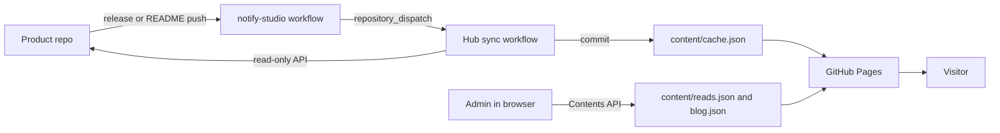
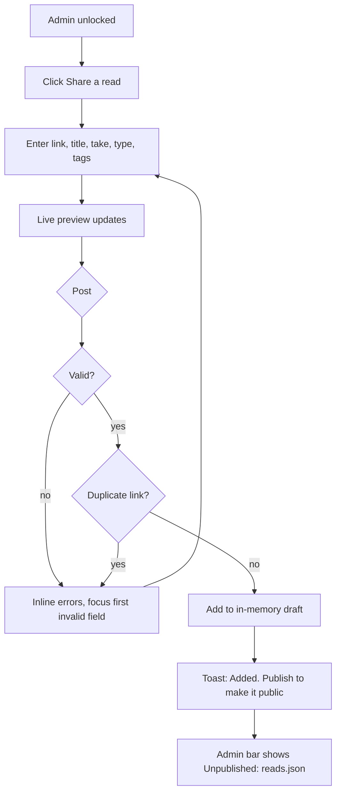
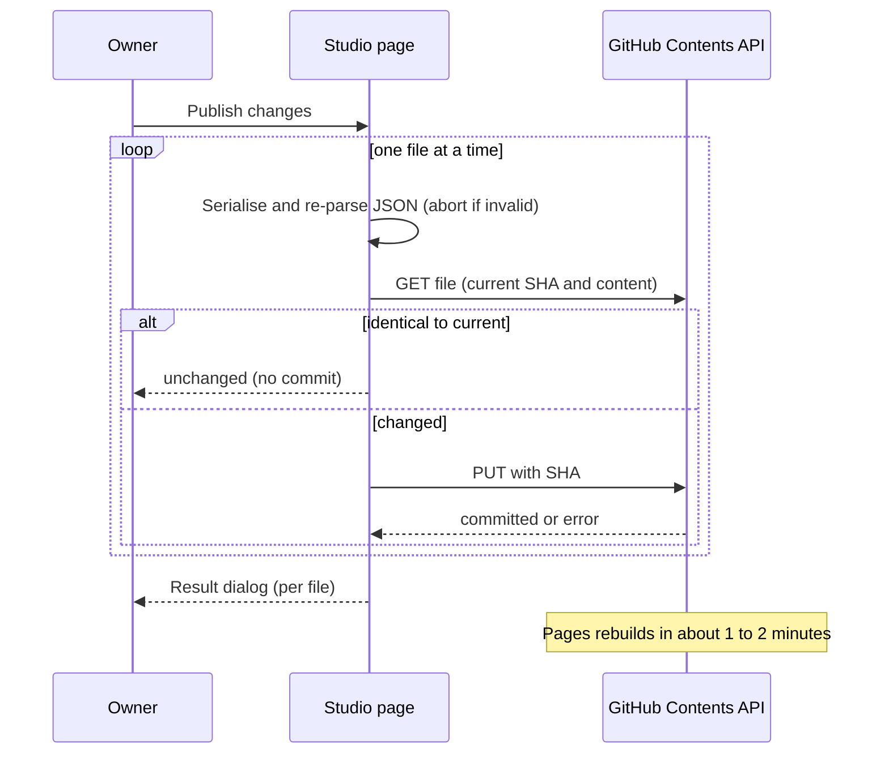
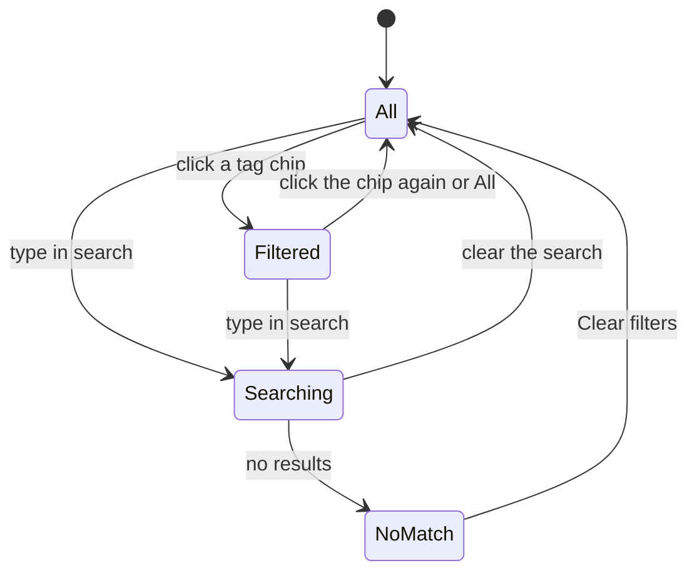
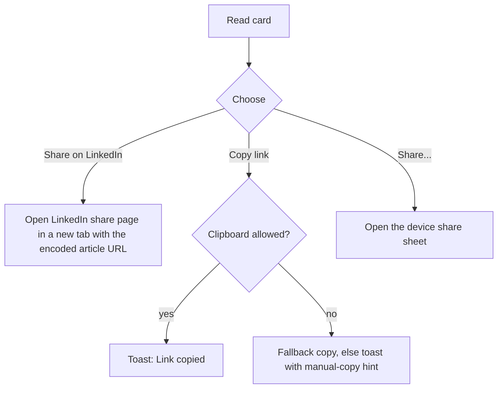
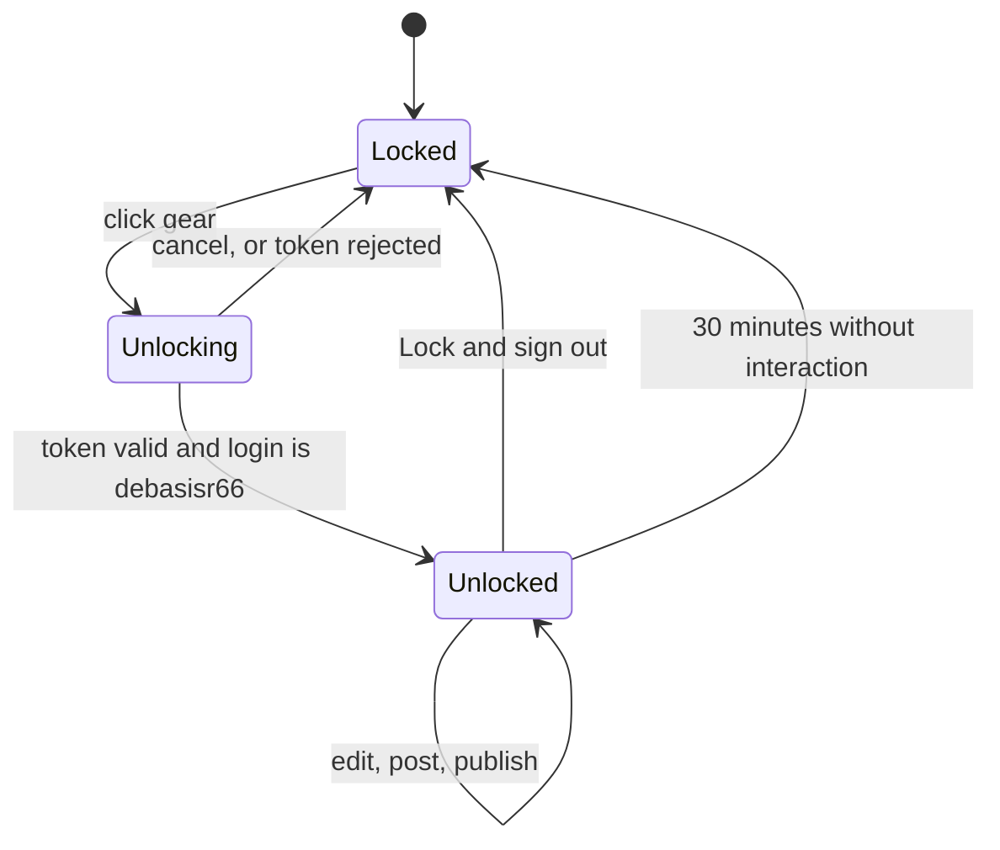

# Design — Studio v1.1

UI sections, HCI best practices applied, and the flows behind the Reads feature. Diagrams are Mermaid and render on GitHub.

## 1. Brand

**Studio by Debasis Ray — learning never ends!** Wordmark "Studio" with a muted "by Debasis Ray" in the header; the tagline "Learning never ends!" sits under the hero heading and in the footer. Dark-first with light mode; purple accent `#6E56CF`; Inter for UI text, JetBrains Mono for version tags and metadata.

## 2. HCI principles applied

| Principle | Where it shows up |
|-----------|-------------------|
| Visibility of system status (Nielsen 1) | Loading skeleton cards; "Live from GitHub" label; admin bar shows "Unpublished: reads.json"; toast announces added, saved, deleted, copied, locked; result of a publish shown in a dialog |
| Match with the real world (2) | "Share a read…", "Your take", "Post" mirror familiar social-post language; plain error text ("Add a title") |
| User control and freedom (3) | Cancel on every form; Escape closes dialogs and the composer; edits stay in a draft until **Publish**; confirmation before delete and before signing out with unpublished changes |
| Consistency and standards (4) | One button style per role (primary, ghost); tag chips look and behave the same everywhere; native form controls |
| Error prevention (5) | Live preview before posting; 280-character counter; duplicate-link check; links normalised and tracking parameters stripped; JSON validated before any commit |
| Recognition over recall (6) | Visible labels on every field (no placeholder-only labels); tag chips offer existing tags; "Clear filters" appears with empty results |
| Flexibility and efficiency (7) | Search plus tag filter; Enter submits the token dialog; keyboard operable throughout; skip link |
| Aesthetic and minimalist design (8) | Composer collapsed to one prompt until needed; long release notes collapsed behind "Show release notes" (progressive disclosure); toolbar appears only with 4 or more reads |
| Help users recover from errors (9) | Inline, specific messages next to the field, announced via `role="alert"`, focus moved to the first invalid field |
| Help and documentation (10) | Dialog and field hints state what the token is for and the limits (280 characters, 5 tags) |

Supporting laws and guidelines:

- **Fitts's law / touch ergonomics:** primary controls are at least 44 px tall; coarse-pointer devices get 44 px chips; the mobile bottom nav keeps the three main destinations within thumb reach.
- **Hick's law:** three primary sections on mobile; one primary action per card.
- **Proximity and grouping:** share actions sit in a row at the foot of each card, divided from the content.
- **Progressive disclosure:** composer, release notes and filters reveal on demand.

## 3. Accessibility (WCAG 2.2 AA)

| Area | Implementation |
|------|----------------|
| Structure | One `<h1>`, `<h2>` per section, landmarks (`header`, `nav` ×2 with labels, `main`, `footer`); `lang="en"` |
| Keyboard | Skip link; visible `:focus-visible` ring (≥ 7:1 contrast); dialog traps focus, restores it on close, closes on Escape |
| Names and labels | Every control has a visible or ARIA label; icon-only buttons have `aria-label`; links that open a new tab say so (visually hidden text) |
| Dynamic content | `role="status"` toast; `aria-live="polite"` result counts; `role="alert"` for errors; `aria-pressed` on filter chips; `aria-expanded` on the composer prompt; `aria-current="location"` on the active section |
| Colour and contrast | Tokens measured, not assumed (table below); no meaning conveyed by colour alone |
| Motion | `prefers-reduced-motion` disables animation, transitions and smooth scrolling |
| Target size | ≥ 44 px on primary controls and on touch devices; small tag chips on desktop are 28 px (above the 24 px WCAG 2.2 minimum) |
| Reflow | No horizontal scroll at 375 px; long URLs wrap |

Measured contrast (WCAG ratios):

| Pair | Ratio | Result |
|------|-------|--------|
| Dark: text on background | 16.6 | Pass |
| Dark: muted text on surface | 5.4 | Pass |
| Dark: accent text on surface | 4.7 | Pass |
| White on accent button | 5.4 | Pass |
| White on button **hover** (v1.0 value `#8470E0`) | 3.9 | **Failed, fixed** to `#5B43BB` (7.1) |
| Light: muted text on surface | 4.7 | Pass |
| Light: danger `#F2555A` on white (v1.0) | 3.4 | **Failed, fixed** to `#C62F3A` (5.4) |
| Form field borders (v1.0 `#26262E`, 1.3:1) | 1.3 | **Failed (needs 3:1), fixed** with `--field`: 3.6–3.9 |
| Focus ring, dark / light | 7.5 / 6.8 | Pass |

## 4. Layout and responsive behavior

| Width | Behavior |
|-------|----------|
| ≥ 861 px | 3-column product grid; Reads is two columns (list wider than Books); top nav |
| 621–860 px | 2-column product grid; Reads stacks |
| ≤ 620 px | 1 column; top links replaced by a bottom nav (Products, Blog, Reads); admin bar sits above it; the gear is hidden while admin is on |

Grids use `minmax(0, 1fr)` and text uses `overflow-wrap: anywhere`, so one long URL can never widen the page.

## 5. Components

| Component | Notes |
|-----------|-------|
| Product card | Category and version tags, name, tagline, language, stars, updated date; **Open app** (primary), **Download** or **Release**, **Source**; opens in a new tab with `noopener noreferrer` |
| Reads composer | Collapsed pill "Share a read…" → form: Link, Title, Your take (≤ 280), Type, Tags (≤ 5), live Preview, Cancel and Post (or Save changes) |
| Read card | Avatar (local, from domain), title link, domain · type · date, comment, tag chips (filter), share row: **Share on LinkedIn**, **Copy link**, **Share…** (when the device supports it) |
| Toolbar | Search field and tag chips; hidden until there are 4 or more reads |
| Toast | One live region; 3.5-second auto-hide |
| Dialog | `role="dialog" aria-modal`, labelled by its title, focus trap |
| Admin bar | Pending changes, **Lock & sign out**, **Publish changes**; auto-lock after 30 minutes idle |

## 6. Flows

### 6.1 System context



### 6.2 Add a read (owner)



### 6.3 Publish



### 6.4 Browse and filter (visitor)



### 6.5 Share (visitor)



Only the original article URL is shared. Studio sends nothing to LinkedIn until the visitor clicks.

### 6.6 Admin lock and unlock



Locking clears the token from the browser but keeps unpublished drafts in memory until the page is reloaded; the page warns before unload.

## 7. Microcopy

Plain, specific, and actionable:

- "Enter a valid web address starting with http:// or https://"
- "This link is already in your reading list."
- "Added. Publish to make it public."
- "Admin locked after 30 minutes of inactivity."
- "Live data is unavailable right now — showing basic product info."
- Empty states say what will happen: "No releases published yet. Release notes will appear here automatically."

## 8. Data (Reads)

```json
{
  "articles": [
    {
      "id": 1760860000000,
      "added": "2026-10-19",
      "title": "…",
      "url": "https://example.com/post",
      "comment": "Why it is worth reading (max 280 characters)",
      "kind": "article | video | paper | podcast | tool",
      "tags": ["ai", "architecture"]
    }
  ],
  "books": []
}
```

Old entries `{ "title", "url", "note" }` remain valid and are shown as before.
