# Design — Studio

Releases: v2.0 (proposed: §12) · v1.4 (fonts, profile photo, logo, protection and keep-alive: §11) · v1.3 (What's new, admin session, strict CSP: §10) · v1.2 (operational flows: §9; no UI change) · v1.1 (UI: §1–8).

UI sections, HCI best practices applied, and the flows behind the Reads feature. Diagrams are Mermaid and render on GitHub.

## 1. Brand

**Studio by Debasis Ray — learning never ends!** Wordmark "Studio" with a muted "by Debasis Ray" in the header; the tagline "Learning never ends!" sits under the hero heading and in the footer. Dark-first with light mode; purple accent `#6E56CF`; Inter for UI text, JetBrains Mono for version tags and metadata.

## 2. HCI principles applied

| Principle | Where it shows up |
|-----------|-------------------|
| Visibility of system status (Nielsen 1) | Loading skeleton cards; "Live from GitHub" label; admin bar shows "Unpublished: reads.json"; toast announces added, saved, deleted, copied, locked; result of a publish shown in a dialog |
| Match with the real world (2) | "Share a read…", "Your take", "Post" mirror familiar social-post language; plain error text ("Add a title") |
| User control and freedom (3) | Cancel on every form; Escape closes dialogs and the composer; edits stay in a draft until **Publish**; confirmation before delete and before signing out with unpublished changes |
| Consistency and standards (4) | One button style per role (primary, ghost); tag chips look and behave the same everywhere; native form controls |
| Error prevention (5) | Live preview before posting; 280-character counter; duplicate-link check; links normalised and tracking parameters stripped; JSON validated before any commit |
| Recognition over recall (6) | Visible labels on every field (no placeholder-only labels); tag chips offer existing tags; "Clear filters" appears with empty results |
| Flexibility and efficiency (7) | Search plus tag filter; Enter submits the token dialog; keyboard operable throughout; skip link |
| Aesthetic and minimalist design (8) | Composer collapsed to one prompt until needed; long release notes collapsed behind "Show release notes" (progressive disclosure); toolbar appears only with 4 or more reads |
| Help users recover from errors (9) | Inline, specific messages next to the field, announced via `role="alert"`, focus moved to the first invalid field |
| Help and documentation (10) | Dialog and field hints state what the token is for and the limits (280 characters, 5 tags) |

Supporting laws and guidelines:

- **Fitts's law / touch ergonomics:** primary controls are at least 44 px tall; coarse-pointer devices get 44 px chips; the mobile bottom nav keeps the three main destinations within thumb reach.
- **Hick's law:** three primary sections on mobile; one primary action per card.
- **Proximity and grouping:** share actions sit in a row at the foot of each card, divided from the content.
- **Progressive disclosure:** composer, release notes and filters reveal on demand.

## 3. Accessibility (WCAG 2.2 AA)

| Area | Implementation |
|------|----------------|
| Structure | One `<h1>`, `<h2>` per section, landmarks (`header`, `nav` ×2 with labels, `main`, `footer`); `lang="en"` |
| Keyboard | Skip link; visible `:focus-visible` ring (≥ 7:1 contrast); dialog traps focus, restores it on close, closes on Escape |
| Names and labels | Every control has a visible or ARIA label; icon-only buttons have `aria-label`; links that open a new tab say so (visually hidden text) |
| Dynamic content | `role="status"` toast; `aria-live="polite"` result counts; `role="alert"` for errors; `aria-pressed` on filter chips; `aria-expanded` on the composer prompt; `aria-current="location"` on the active section |
| Colour and contrast | Tokens measured, not assumed (table below); no meaning conveyed by colour alone |
| Motion | `prefers-reduced-motion` disables animation, transitions and smooth scrolling |
| Target size | ≥ 44 px on primary controls and on touch devices; small tag chips on desktop are 28 px (above the 24 px WCAG 2.2 minimum) |
| Reflow | No horizontal scroll at 375 px; long URLs wrap |

Measured contrast (WCAG ratios):

| Pair | Ratio | Result |
|------|-------|--------|
| Dark: text on background | 16.6 | Pass |
| Dark: muted text on surface | 5.4 | Pass |
| Dark: accent text on surface | 4.7 | Pass |
| White on accent button | 5.4 | Pass |
| White on button **hover** (v1.0 value `#8470E0`) | 3.9 | **Failed, fixed** to `#5B43BB` (7.1) |
| Light: muted text on surface | 4.7 | Pass |
| Light: danger `#F2555A` on white (v1.0) | 3.4 | **Failed, fixed** to `#C62F3A` (5.4) |
| Form field borders (v1.0 `#26262E`, 1.3:1) | 1.3 | **Failed (needs 3:1), fixed** with `--field`: 3.6–3.9 |
| Focus ring, dark / light | 7.5 / 6.8 | Pass |

## 4. Layout and responsive behavior

| Width | Behavior |
|-------|----------|
| ≥ 861 px | 3-column product grid; Reads is one column (the reads, then Books; SPEC-UX UX-02); top nav |
| 621–860 px | 2-column product grid; Reads stacks |
| ≤ 620 px | 1 column; top links replaced by a bottom nav (Products, Updates, Reads, Podcasts); admin bar sits above it; the gear is hidden while admin is on |

Grids use `minmax(0, 1fr)` and text uses `overflow-wrap: anywhere`, so one long URL can never widen the page.

## 5. Components

| Component | Notes |
|-----------|-------|
| Product card | Category and version tags, name, tagline, language, stars, updated date; **Open app** (primary), **Download** or **Release**, **Source**; opens in a new tab with `noopener noreferrer` |
| Reads composer | Collapsed pill "Share a read…" → form: Link, Title, Your take (≤ 280), Type, Tags (≤ 5), live Preview, Cancel and Post (or Save changes) |
| Read card | Avatar (local, from domain), title link, domain · type · date, comment, tag chips (filter), share row: **Share on LinkedIn**, **Copy link**, **Share…** (when the device supports it) |
| Toolbar | Search field and tag chips; hidden until there are 4 or more reads |
| Toast | One live region; 3.5-second auto-hide |
| Dialog | `role="dialog" aria-modal`, labelled by its title, focus trap |
| Admin bar | Pending changes, **Lock & sign out**, **Publish changes**; auto-lock after 30 minutes idle |

## 6. Flows

### 6.1 System context

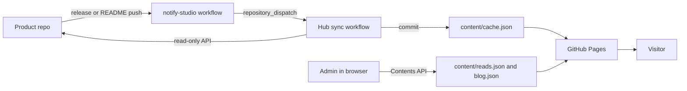

### 6.2 Add a read (owner)

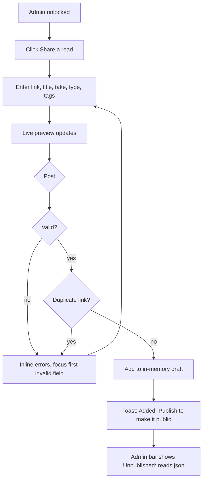

### 6.3 Publish

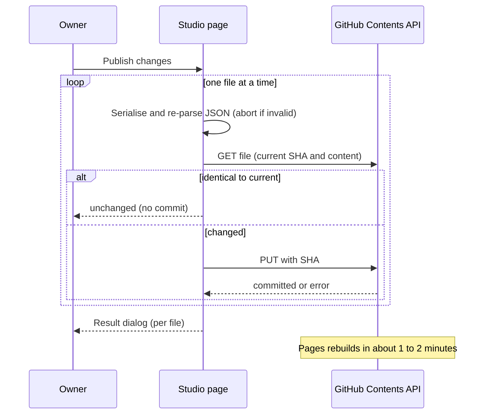

### 6.4 Browse and filter (visitor)

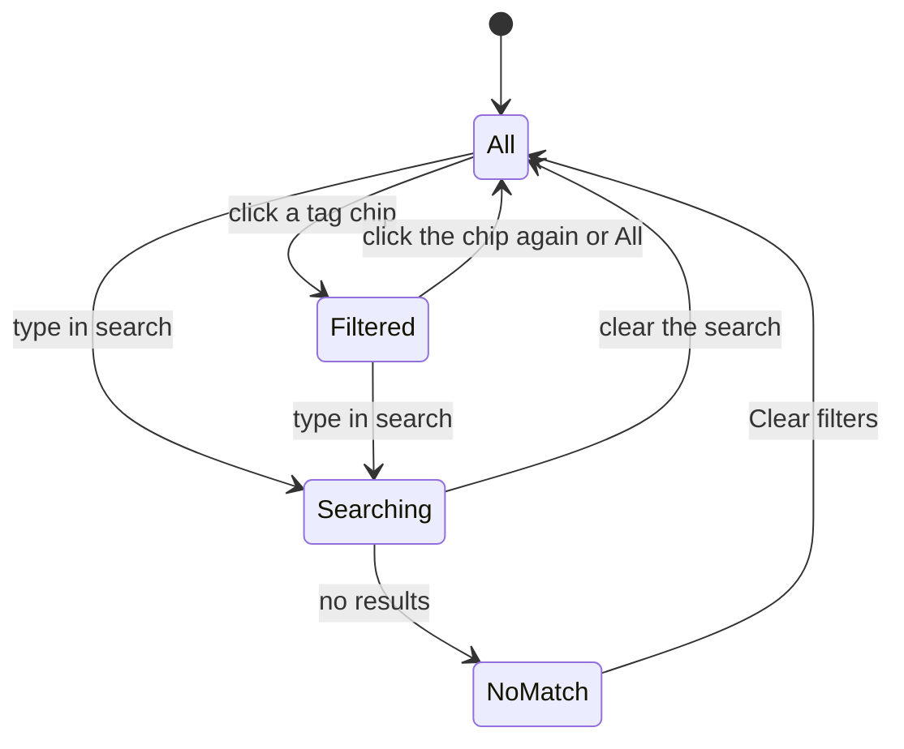

### 6.5 Share (visitor)

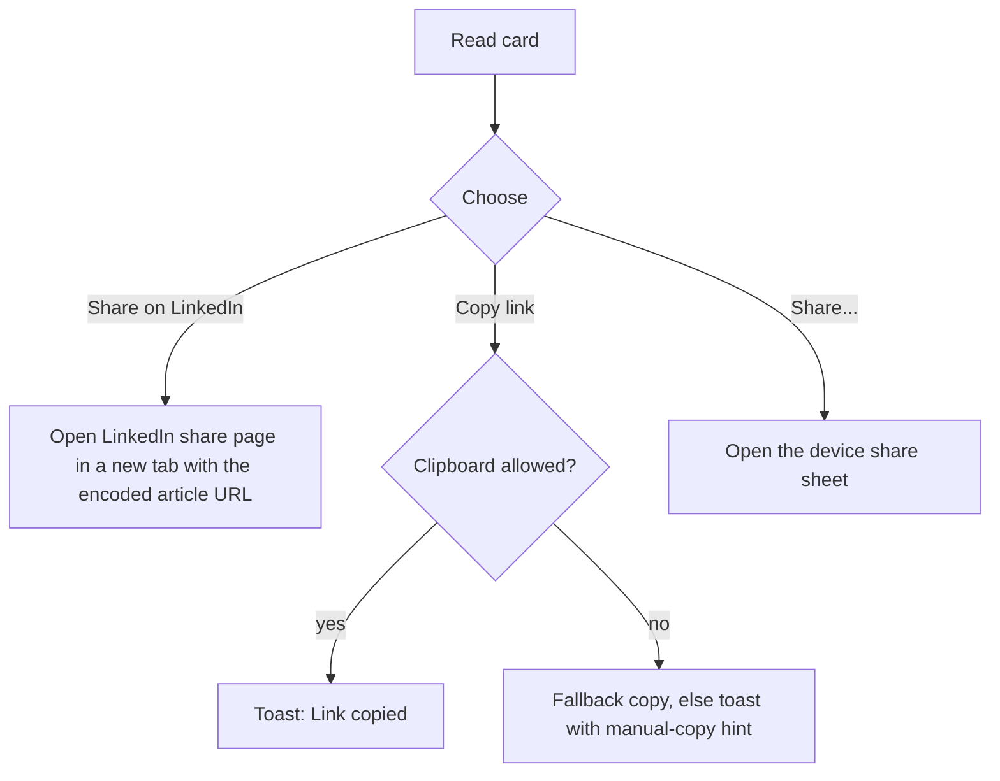

Only the original article URL is shared. Studio sends nothing to LinkedIn until the visitor clicks.

### 6.6 Admin lock and unlock

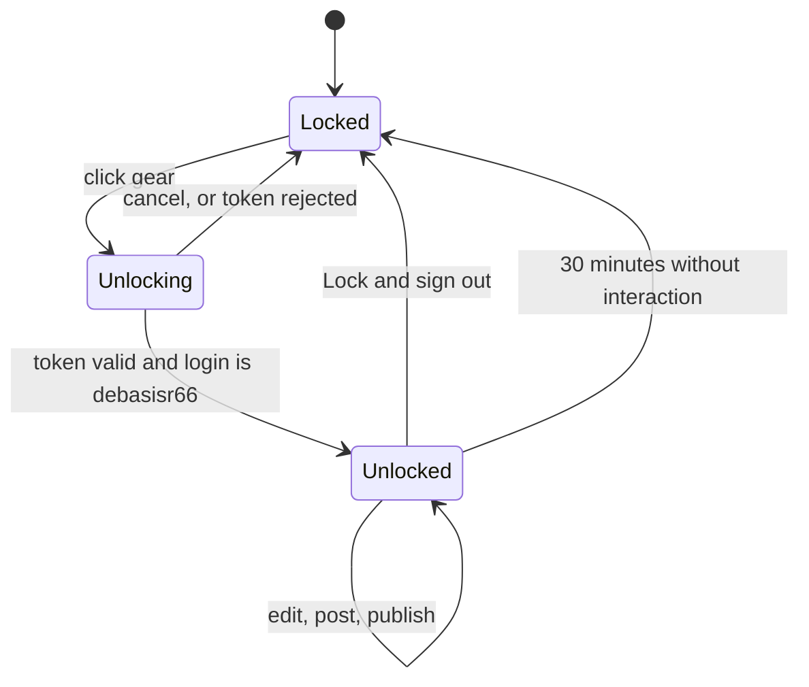

Locking clears the token from the browser but keeps unpublished drafts in memory until the page is reloaded; the page warns before unload.

## 7. Microcopy

Plain, specific, and actionable:

- "Enter a valid web address starting with http:// or https://"
- "This link is already in your reading list."
- "Added. Publish to make it public."
- "Admin locked after 30 minutes of inactivity."
- "Live data is unavailable right now — showing basic product info."
- Empty states say what will happen: "No releases published yet. Release notes will appear here automatically."

## 8. Data (Reads)

```json
{
  "articles": [
    {
      "id": 1760860000000,
      "added": "2026-10-19",
      "title": "…",
      "url": "https://example.com/post",
      "comment": "Why it is worth reading (max 280 characters)",
      "kind": "article | video | paper | podcast | tool",
      "tags": ["ai", "architecture"]
    }
  ],
  "books": []
}
```

Old entries `{ "title", "url", "note" }` remain valid and are shown as before.

## 9. Operational flows (v1.2)

How the safety net works. Nothing here is visible to visitors.

### 9.1 What runs when

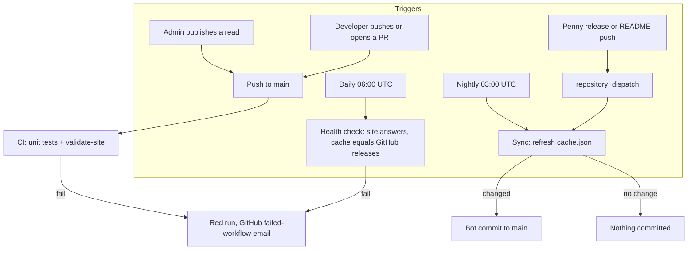

The sync bot's own commit does not start CI (GitHub does not run workflows for `GITHUB_TOKEN` pushes), which is why the daily health check exists.

### 9.2 Validator decision flow

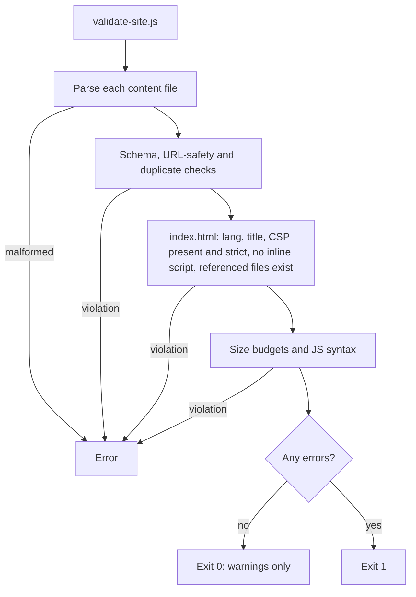

Errors fail the run; warnings (a repeated link, a product not cached yet) are printed but never fail it.

### 9.3 Health check

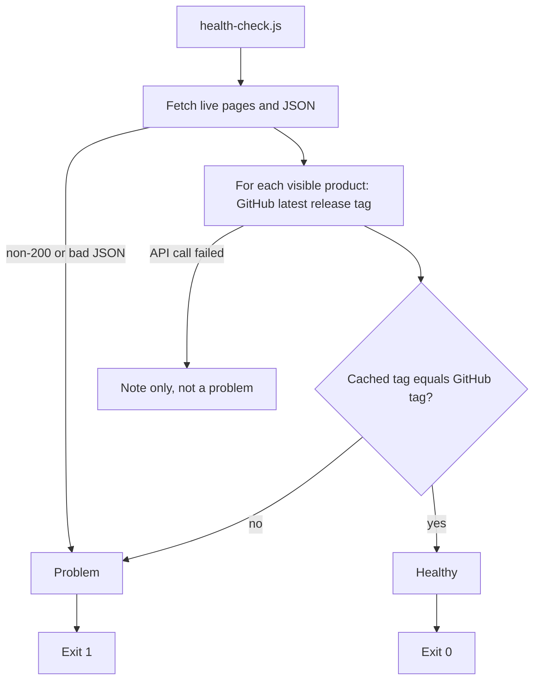

### 9.4 Why the cache no longer churns

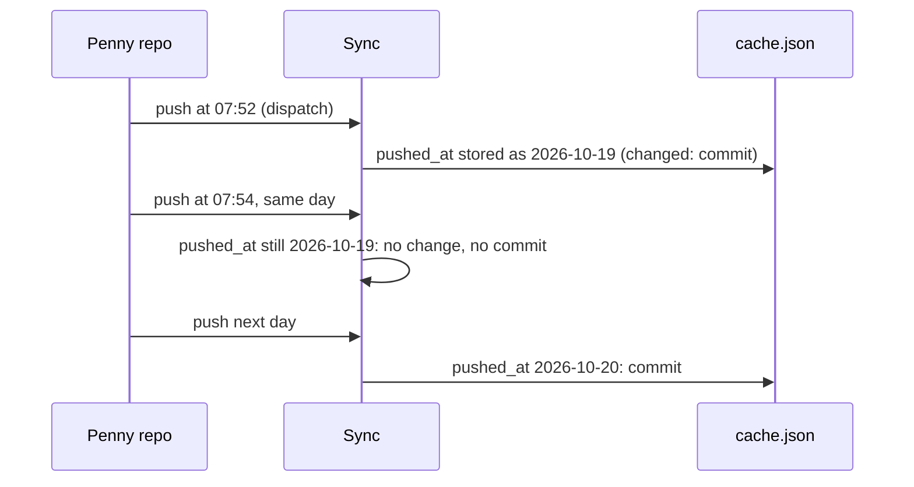

Before: the exact timestamp changed on every push, so each push produced a commit (three within five minutes on 2026-10-19). The page only ever showed the date.

### 9.5 Dates

Date-only values (`2026-10-19`) are calendar dates and are formatted in UTC; full timestamps keep local-time formatting. A visitor in Los Angeles now sees "19 Oct 2026", not "18 Oct 2026".

## 10. v1.3 design — What's new, admin session, strict CSP

### 10.1 What's new

**Purpose:** let a visitor tell which version they are looking at and understand, in plain language, what changed and when.

**Placement**

| Where | Element | Behavior |
|-------|---------|----------|
| Header, left of the theme button | **What's new** button (text on desktop; a ✦ icon with the same accessible name on phones) with a small dot when there is an update the visitor has not seen | Opens the dialog |
| Footer | Version label `Studio v1.3`, a button; "Synced from GitHub · date" stays together so it never splits across lines on a phone | Opens the same dialog |
| Dialog | "What's new in Studio": releases newest first; the latest carries a **Latest** badge | Close button, Escape, click outside |

**Focus on open:** the dialog title takes focus (not the Close button at the bottom), so a long list opens at the top; closing returns focus to whichever button opened it.

**Release entry:** version badge (`v1.3`), date, a short title, then 2–5 plain-text bullets. No links, no markup, no jargon ("tighter security rules" rather than "CSP"). The dialog scrolls when long; the existing dialog rules (focus trap, focus restore, Escape) apply.

**States**

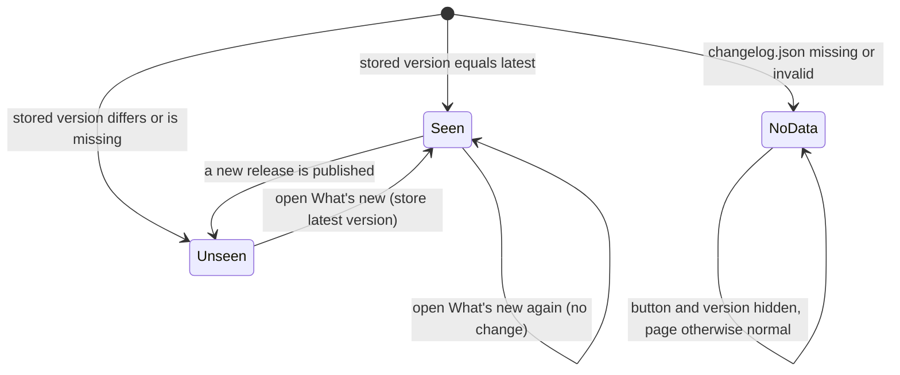

If the browser blocks `localStorage`, the visitor cannot be tracked, so no dot is shown (the dialog still works).

**Flow**

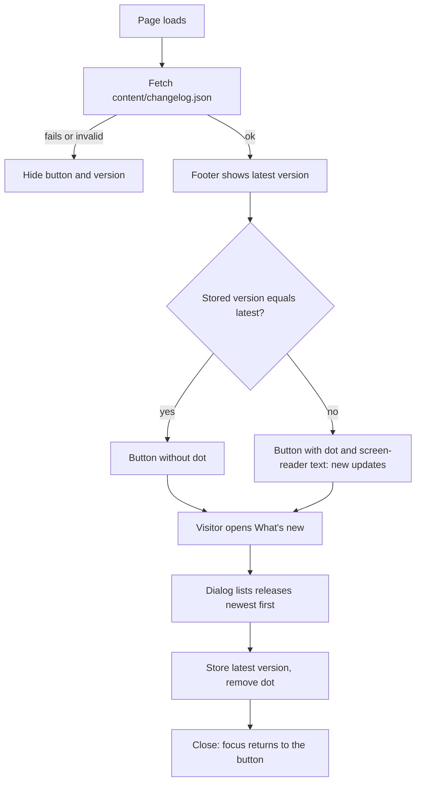

**Data** (`content/changelog.json`, newest first, edited by git):

```json
{
  "releases": [
    { "version": "1.3", "date": "2026-10-19", "title": "Safer sign-in and What's new",
      "items": ["See what changed: the new What's new button lists every release.", "…"] }
  ]
}
```

Rules enforced in CI: at least one release; `version` like `1.3` or `1.3.1`; strictly descending; `date` is `YYYY-MM-DD`; title up to 80 characters; 1–6 items, each up to 160 characters; everything is plain text (escaped when shown).

**Backfilled release notes (user language)**

| Version | Title | Items |
|---------|-------|-------|
| v1.3 | Safer sign-in and What's new | See what changed with the new What's new button · The version now shows at the bottom of every page · Admin sign-in is forgotten when the tab closes · Tighter security rules for page styling |
| v1.2 | Reliability | Automatic checks on every change and every day to catch problems early · Dates show the right day in every timezone · Download buttons can point at the right file (Penny now downloads the app, not a document) |
| v1.1 | Reads and a refreshed look | Share a read: a searchable reading list with tag filters, Share on LinkedIn and Copy link · Studio by Debasis Ray, learning never ends! · Easier to use: keyboard friendly, clearer colours, larger touch targets, light and dark themes · Phone fix: long release notes no longer push the page sideways and are collapsed |
| v1.0 | Launch | Products pulled live from GitHub with release notes and downloads · Updates feed · Blog and Books |

**Microcopy:** button "What's new"; dialog title "What's new in Studio"; badge "Latest"; screen-reader text "New updates available".

**Accessibility:** a real `<button>` with `aria-haspopup="dialog"` and an explicit `aria-label` ("What's new", or "What's new, new updates available" when there is news), because on phones the visible text is hidden and the icon is decorative (an unnamed button was found and fixed during testing); the dot is decorative; the dialog is the existing `role="dialog" aria-modal` component (title as `h3`, releases as `h4` inside a list); no colour-only signal; target size at least 40 px (44 px on phones); dot colour meets 3:1 against the header.

### 10.2 Admin session

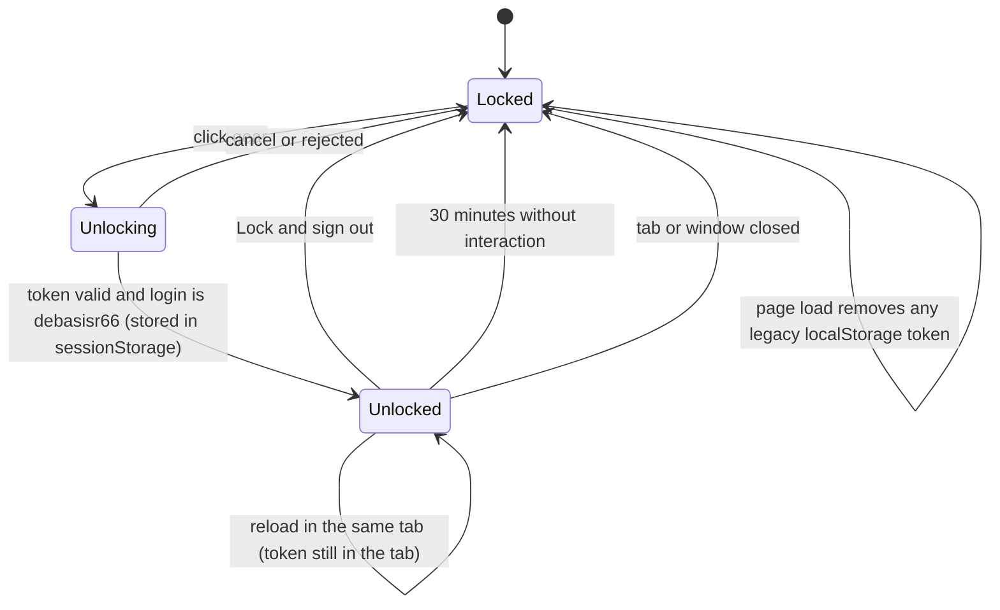

| Item | Behavior |
|------|----------|
| Where the token lives | `sessionStorage` for this tab only; never `localStorage`, a cookie, the URL or the DOM |
| Other tabs | Not signed in; unlock again |
| Browser blocks `sessionStorage` | Token held in memory only; a reload locks; the dialog works as normal |
| Old stored token | Deleted silently on load. Not copied into the new store |
| Unlock dialog text | "Paste a GitHub personal access token with write access to debasisr66/studio. It stays in this tab only and is forgotten when you close it." |

Expected one-time surprise for the owner: sign in again after this release. It is stated in the release notes and the learning guide.

### 10.3 Strict CSP

| Directive | v1.2 | v1.3 |
|-----------|------|------|
| `script-src` | `'self'` | `'self'` |
| `style-src` | `'self' 'unsafe-inline' https://fonts.googleapis.com` | `'self' https://fonts.googleapis.com` |
| Others | unchanged | unchanged (`default-src 'none'`, `connect-src 'self' https://api.github.com`, `font-src https://fonts.gstatic.com`, `img-src 'self' data:`, `base-uri 'none'`, `form-action 'none'`) |

How the page keeps working without inline styles:

1. The `<style>` block moves verbatim to `css/site.css`, linked from the head.
2. Each of the 12 inline `style=` uses becomes a class (for example `.opt` for lighter label text, `.spacer`, `.btn-sm`, `.mt10`, `.m0`, `.grid-full`, `.muted-sm`, `.pre-result`).
3. Two values are genuinely dynamic: the avatar colour (a hue from the domain) and the language dot colour. The markup carries `data-h` and `data-bg`; after each render, a small routine applies them with `element.style.setProperty(...)`, which a strict CSP allows (it blocks style *attributes in markup*, not style changes made by script).
4. Anything that would reintroduce `style=` or `<style>` fails CI (validator rule).

### 10.4 Token module

The token logic lives in `js/token-store.js` (no DOM access, unit-tested): `create(getStorage, key)` returns `get`, `set`, `del` over the given storage with an in-memory fallback; `purge(getStorage, key)` deletes a legacy token. The page passes `sessionStorage` to `create` and `localStorage` to `purge`.

### 10.5 Visual-regression approach

Because the CSS file moves, the design is only accepted if v1.2 and v1.3 render identically. A test harness loads both builds in same-origin frames at 375, 768 and 1280 px, in dark and light, with identical content, and compares computed styles element by element. Only the What's new button and the footer version may differ.

## 11. v1.4 design — fonts, profile photo, logo, protection, keep-alive

### 11.1 Self-hosted fonts

| | v1.3 | v1.4 |
|---|------|------|
| Where fonts load from | `fonts.googleapis.com` (CSS) and `fonts.gstatic.com` (files) | `fonts/` on the same origin |
| CSP `style-src` / `font-src` | `'self' https://fonts.googleapis.com` / `https://fonts.gstatic.com` | `'self'` / `'self'` |
| Third parties that see a visit | Google | None |
| Files | n/a | `inter-latin.woff2`, `inter-latin-ext.woff2`, `jetbrains-mono-latin.woff2`, `jetbrains-mono-latin-ext.woff2` (variable fonts: Latin and Latin Extended), plus their SIL Open Font Licence texts |

- `css/site.css` declares `@font-face` for each file with `font-display: swap`, so text shows at once in the fallback stack and swaps when the font arrives.
- **Design change found in testing:** the first design shipped only the Latin subset. The visual comparison showed the **rupee sign (₹, U+20B9) lives in the Latin Extended subset**, so a Latin-only build changed its width. Both subsets are now self-hosted, the browser downloads an Extended file only when a page uses one of its characters, and CI requires the Inter faces to cover U+20B9. Other scripts (for example Devanagari in a future post) fall back to the system font by design.
- The Inter file is preloaded (`<link rel="preload" as="font" crossorigin>`), which the CSP allows under `font-src 'self'`.
- Fallback stack is unchanged (`system-ui…` and `ui-monospace…`), so a failed font load only changes letter shapes slightly.
- CI rules: `style-src` and `font-src` may contain only `'self'`; `index.html` may not link any external stylesheet or font; each font file needs a licence file beside it and a size budget.

### 11.2 Profile photo

**Purpose:** put a face to "Studio by Debasis Ray". Owner-only upload; public display.

**Hero layout**

| Width | Layout |
|-------|--------|
| Desktop and tablet | A 96 px round photo to the left of the eyebrow line "Studio by Debasis Ray" |
| Phone | The same, 72 px, above the heading |
| No photo yet | A round monogram "D" (the existing avatar style) in the same place, so nothing shifts when a photo is added |

The image has `alt="Debasis Ray"` and fixed `width`/`height`, so loading never moves the page.

**Admin flow**

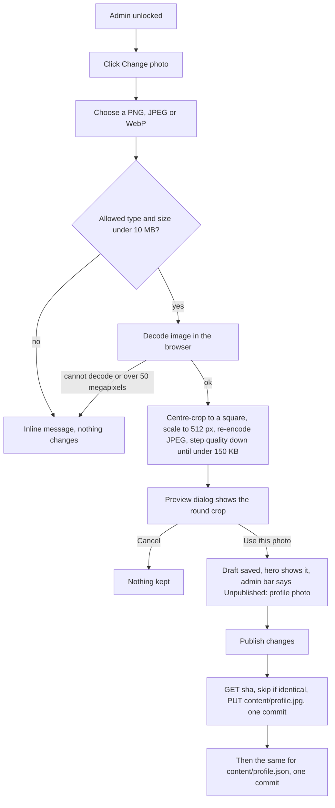

**Rules** (enforced in `js/image-lib.js`, unit-tested)

| Rule | Value |
|------|-------|
| Accepted types | `image/png`, `image/jpeg`, `image/webp` (**no SVG, no GIF**) |
| Input file size | At most 10 MB |
| Decoded size | At most 50 megapixels (guards against decompression bombs) |
| Output | Square centre crop, 512 × 512, JPEG, quality 0.86 stepping down to 0.60 until the file is at most 150 KB |
| Metadata | None survives: re-encoding drops EXIF (including location) |
| Stored as | `content/profile.jpg` plus a tiny manifest `content/profile.json` (`{"photo": "content/profile.jpg", "updated": "<UTC timestamp>"}`): two files, **two commits**, photo first so the manifest never points at a missing file |

**Privacy note shown in the dialog:** "The photo will be public once published. Location and camera details are removed."

**Why a manifest (design change found while building):** without it, every visit before a photo exists would request a file that returns an error (console noise), and a replaced photo could be served stale for up to ten minutes. With it, the page shows a photo only when the manifest names one, requests it as `content/profile.jpg?v=<timestamp>` (a new photo is a new URL, so it is never stale), and restricts the path to `content/*.jpg` so it can never point at another site.

**After publishing:** the admin keeps seeing the local copy for the rest of the session (the published URL is not served until Pages rebuilds, a minute or two); visitors get the new photo as soon as the site is rebuilt.

**Microcopy:** "Change photo" · "Use this photo" · "Choose a PNG, JPEG or WebP image up to 10 MB." · "That file isn't a usable image." · "Photo ready. Publish to make it public."

**Accessibility:** a real button with a visible label (not icon-only); the file chooser is native; the preview dialog follows the existing dialog rules; errors are announced; the photo has alt text.

**Validator (CI):** if `content/profile.jpg` exists it must start with the JPEG signature, be at most 200 KB, and be between 128 and 1024 pixels on each side (read from the JPEG header); `profile.json` must have a null photo or a path like `content/profile.jpg` with a UTC timestamp, and the file it names must exist.

### 11.3 Logo

Chosen: **Lattice Ascent** (option 2): a 4 × 4 grid of rounded squares that grow and twist toward one bright cell. Concept: structure that scales (engineering at scale) rising to one product; many cells, one point of focus. Concepts 1 (Open Orbit) and 3 (Convergence) stay in `docs/brand/`.

| Use | Rule |
|-----|------|
| File | `assets/logo.svg` (128-unit viewBox, no scripts, no external references) |
| Header | 28 px mark followed by the "Studio" wordmark; decorative (`alt=""`) because the wordmark carries the name |
| Favicon | The same SVG |
| Colour | Dark tile `#15131F`; purples `#2A2250 → #8470E0`; one amber cell `#F5B544` (the only warm colour in the product) |
| Clear space | At least a quarter of the mark's width on every side |
| Do not | Recolour the amber cell, stretch, add effects or place on a busy background |

### 11.4 Protecting `main`

**What is in force:** one ruleset, **history protected**: nobody (including the owner) can delete `main` or force-push to it. **What is not:** a "CI required" ruleset. It was built, applied temporarily and tested; the tests showed it cannot coexist with the bots, so it was removed (evidence below). CI gating is by process instead.

| Ruleset | Rules | Bypass | Status |
|---------|-------|--------|--------|
| **History** | No deletion of `main`; no force-push | None | **In force** |
| **CI required** | Required status check `check` | Admin role only (GitHub does not accept the Actions app as a bypass actor on a personal repository) | **Tested, not applied** |

What the experiment on 2026-10-20 showed (details in `test.md` §F):

| Actor and action | With the CI ruleset | Final configuration (history only) |
|------------------|---------------------|------------------------------------|
| Owner merges a PR with failing CI, normally | **Refused** ("the base branch policy prohibits the merge"); only `--admin` overrides | Allowed (by process, merge only after `gh pr checks` is green) |
| Owner or admin screen: direct commit to `main` | Allowed (admin bypass) | Allowed |
| **Sync and keep-alive bots: direct commit** | **Rejected** (`Required status check "check" is expected`) | Allowed |
| Anyone, including the owner: force-push or delete `main` | Rejected | **Rejected** (tested on a throwaway branch with identical rules) |

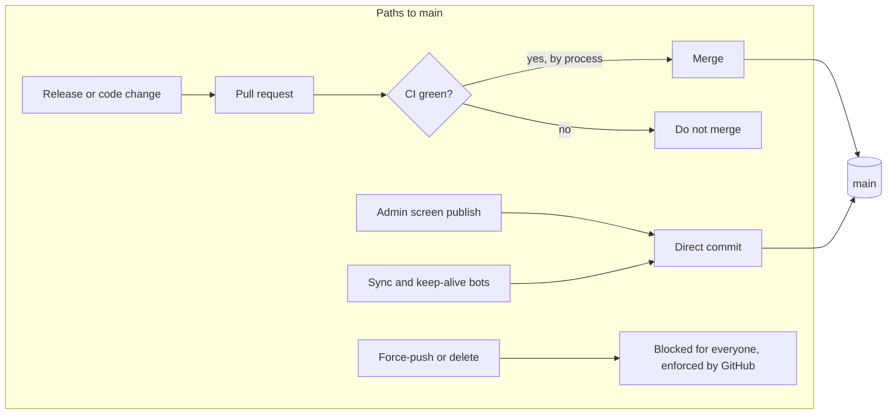

**Why the CI ruleset was not kept:** a brand-new commit has no checks yet, so a required check rejects any direct push by a non-admin, including the nightly sync and the keep-alive. The bots cannot be exempted. Alternatives were rejected: a personal access token for the bots (a new long-lived secret that expires and silently stops the sync), routing bot commits through pull requests (pull requests opened by the default token do not trigger CI), or a GitHub App (heavy for one person).

**What this means in practice:** history cannot be rewritten or deleted by anyone; CI protects the normal path because releases go through a pull request and are merged only when green; the admin screen and the bots keep working. A bad *content* commit from the admin screen is caught by CI after the fact (red run and email), not prevented.

**Next idea, not built:** gate *deployment* instead of merging (publish with a workflow that runs CI first), which would also stop a bad admin-screen commit from going live. It needs its own design because the bots' pushes do not trigger push workflows.

### 11.5 Keep-alive

GitHub disables scheduled workflows in a public repository after 60 days without repository activity. The keep-alive prevents that without noise.

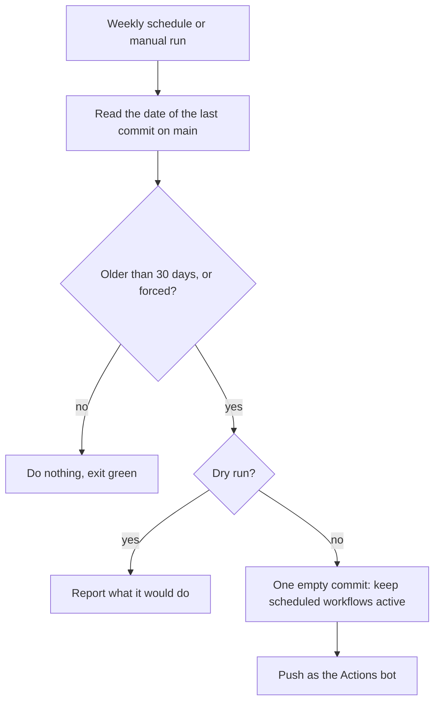

The decision is a pure function (`needsHeartbeat`) with unit tests. The health check additionally fails, naming the workflow, if any workflow is not `active`.

### 11.6 Scheduling reality

Scheduled runs start late: the 03:00 UTC cron ran at 07:42, 07:26, 07:49, 07:55, 08:19 and 08:24 UTC on successive days. Cron times are therefore *approximate*. The health check moves from 06:00 to **12:00 UTC**, well after the sync's usual start, so it normally checks a freshly synced cache; if the sync was late it reports drift only when a release really is missing.

### 11.7 Header fit (found in testing)

Between the phone and desktop layouts (about 620 to 860 px) the header needed more room than it had: the **live v1.3 page overflowed by 23 px at 621 px and by 4 px at 640 px**, because the What's new button joined the links and the "by Debasis Ray" line beside the brand. My earlier checks used 375, 768 and 1280 px, none of which fall in that band. v1.4 hides the small "by Debasis Ray" line below 861 px (the hero says it) and tightens the link spacing. The rule going forward: **sweep many widths** (26 from 320 to 1920 px), not three.

## 12. v2.0 design (proposed; nothing built)

Specs: [SPEC-SH](specs/stabilize-core-hub/spec.md), [SPEC-RC](specs/reads-categories/spec.md), [SPEC-PC](specs/podcast-links/spec.md), [SPEC-UX](specs/simple-layout/spec.md). Constraints carried over: no build step, no npm, strict CSP (no inline code, no third-party host), plain JavaScript, pure logic in small tested modules.

### 12.1 Design principles for 2.0

| Principle | Applied as |
|-----------|-----------|
| Simplicity first | Four top-level destinations; one section anatomy; no settings screen |
| Predictable | One fixed order for every visitor; anchors never change meaning |
| Fail small | One section failing never affects another or the admin unlock |
| Reversible | Additive data changes; rollback tag `v1.5` renders the new data |

### 12.2 Page structure and navigation

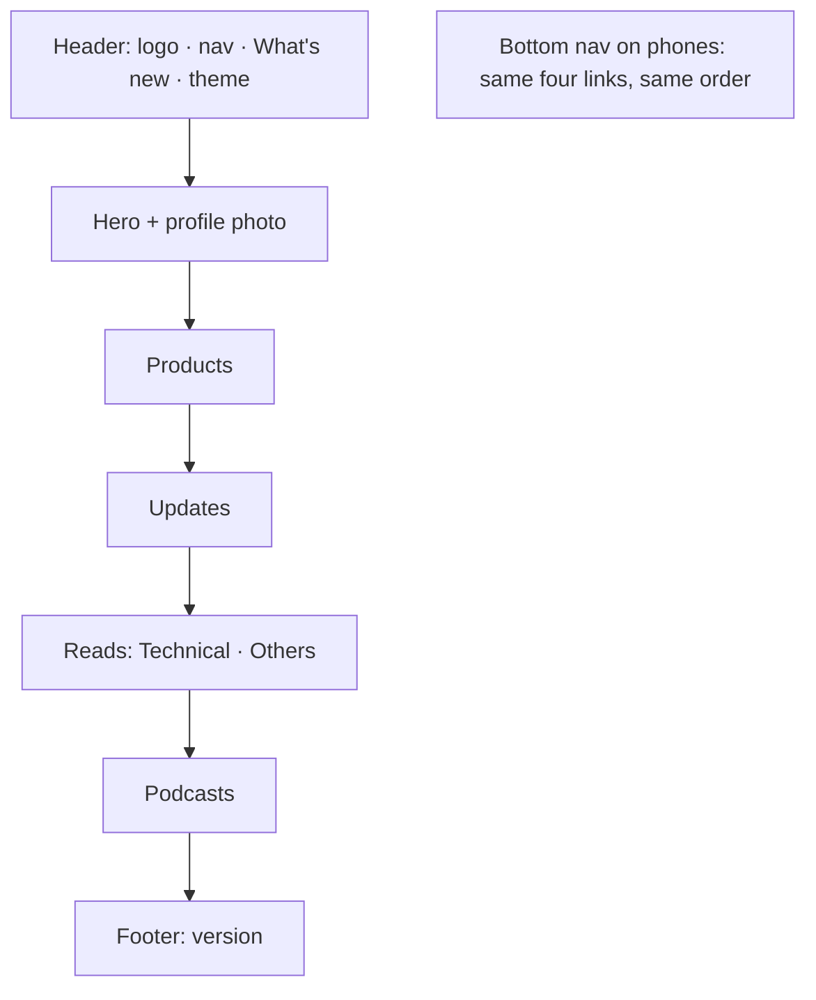

Section anatomy (every section): heading · one-line description · content · empty state · (owner only) one add action. The order is fixed and the same for every visitor. Header nav and bottom nav are generated from the same ordered list, so they cannot disagree.

### 12.3 Section isolation (SH-01, SH-08)

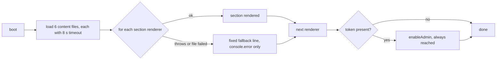

The fallback text is a constant ("This section could not load. The rest of the page is unaffected."); the exception message is never put on the page.

### 12.4 Data model

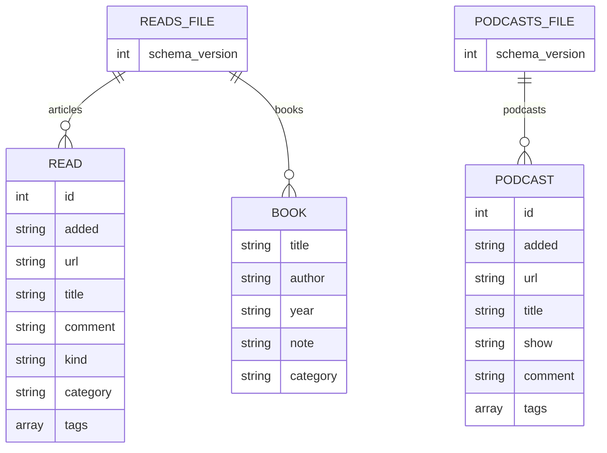

`category` ∈ {technical, other}, closed list in `CATEGORIES`. Browser default for a missing or unknown value is `other`; CI rejects it. `kind` stays a format (article, video, paper, podcast, tool) and is independent. `blog.json` is kept unrendered. `cache.json`, `products.json`, `changelog.json` and `profile.json` are unchanged.


### 12.5 Reads: two sub-items

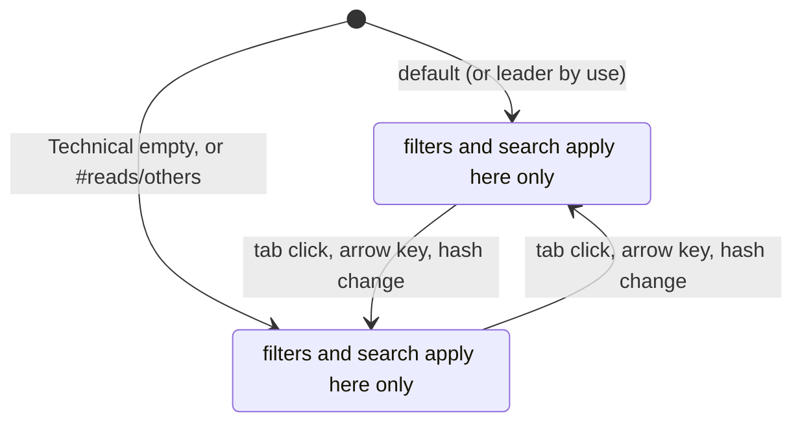

Accessible tab pattern: `role="tablist"`, two `role="tab"` buttons with counts, `aria-selected`, `aria-controls`, roving `tabindex`, Left/Right/Home/End keys, one `role="tabpanel"`. Switching clears tag and search and updates the hash (`#reads/technical`, `#reads/others`) without scrolling. Books render below the articles in the same sub-item (single column); the book editor stays for 2.0. A "No match here" state suggests the other section when it has a match.

**Corrections found while building (RC Phase B):**
1. A tab's count is reads plus books (books are in the same section); the single-column layout is still RC Phase C.
2. A deep link such as `#reads/others` matches no element id, so the browser cannot scroll to it: the page scrolls Reads into view itself, instantly (a smooth scroll was cancelled by layout changes during load).
3. Switching uses `history.replaceState` (no scroll, no history entry); a later change to plain `#reads` keeps the section you are on, only a fresh load applies the default.
4. The composer's Section is a radio group preselected with the last section chosen, else the section being viewed, rather than a blank required choice; the required check remains in `validateEntry` for safety.
5. A section with fewer than 4 reads hides search and tag chips; a search with no match here offers "Try Others" when the other section has a match.

### 12.6 Podcasts: adding and publishing

```mermaid
sequenceDiagram
  actor O as Owner
  participant UI as Composer (Share a podcast)
  participant LIB as lib: normalise and validate
  participant API as GitHub Contents API
  O->>UI: link, title, optional show / take / tags
  UI->>LIB: normalizeUrl, isPublishableUrl, limits
  LIB-->>UI: errors (inline, announced) or clean entry
  UI-->>O: live preview card
  O->>UI: Publish changes
  UI->>API: GET content/podcasts.json (sha)
  UI->>UI: validate whole file; skip if identical
  UI->>API: PUT one file, one commit
  API-->>O: success; Pages updates in about a minute
```

The card: title link, show, platform label from a closed host list (Spotify, Apple Podcasts, YouTube, else the domain), date, take, tags, **Listen →** (new tab, `noopener noreferrer`), share row. No iframe, audio or third-party image.

**Corrections found while building (PC Phase B):**
1. Podcasts is placed after Reads (the final fixed order of SPEC-UX), not where the Blog was; the mobile bottom nav, which never listed Updates, now reads Products, Reads, Podcasts until SPEC-UX unifies the navs.
2. Tag filter chips, copy and share buttons on podcast cards use their own data attributes (`data-pfilter`, `data-ptag`, `data-pcopy`, `data-pshare`), so they cannot collide with the Reads handlers.
3. `#blog` is followed with `location.replace('#podcasts')` (no extra history entry) after the first render and again on every hash change; `redirectHash` is a pure function with a test for every shape of hash.
4. Section isolation for Podcasts is proved with a newer `schema_version`: a `null` entry renders as "Untitled" and does not throw, as with Reads.
5. A legacy fixture for the old Blog (`poison-blog-null`, `missing-blog`) no longer applies; `null-files` also carries a `null` podcasts.json.

### 12.7 Browser smoke test in CI (SH-02)

```mermaid
flowchart LR
  CI[ci.yml step] --> SRV[node static server on localhost, random port]
  SRV --> CH[headless Chrome: --dump-dom with fixture content, two window sizes]
  CH --> AS[Node asserts on the dumped DOM: sections, fallbacks, nav, redirects, no overflow]
  AS -->|pass| OK[green]
  AS -->|fail or over 60 s| RED[red with captured output]
```

Fixture content sets are small JSON folders under `tests/fixtures/site/` laid over the real repo files by the local server (a fixture can also make a file answer 404, hang or answer late). **Built in SH Phase A**; remaining cases (cache missing, release missing, very long text, empty sections) arrive with Phase C.

**Corrections found while building (SH Phase A):**
1. The step is not `--dump-dom`. The runner's Chrome is driven over its DevTools protocol with Node's built-in `WebSocket` (no npm), because that can set the viewport, measure horizontal overflow, read console errors and wait for the page's own `aria-busy` signal.
2. Chrome's temp profile folder is still being written when the browser is killed; the script now waits for Chrome to exit and treats cleanup as best-effort.
3. A content file that is valid JSON `null` made `boot()` throw before any rendering (`blog.value.posts` on `null`). Fixed by accepting only objects (found by a smoke case that failed on the old code).
4. Not every bad input throws: a `null` article renders as "Untitled", so Reads already tolerates it; the Reads isolation case uses a `null` book. The version and profile renderers have no content-reachable throw path, so they are covered by the unit test of `runGuarded` only.
5. `boot()` still waits for all six files together (`Promise.allSettled`), so a file that hangs delays the first render by up to the 8 s limit (the rest of the page then renders normally). Progressive rendering per file would remove the wait; noted as a later option, not needed to meet SH-08.

### 12.8 Interaction, accessibility and HCI checks specific to 2.0

| Item | Check |
|------|-------|
| Tabs | Full keyboard operation, visible focus, 44 px targets, contrast ≥ 4.5:1 in both themes, name and state announced |
| Hash routing | Back button behaves; no scroll jump on tab switch; unknown hash ignored |
| Empty and error states | Plain language, never blank, never raw exception text |
| Podcast card | Link text is the title (not "click here"); platform label is text, not colour only |

### 12.9 Design decisions (with reasons)

| Decision | Why |
|----------|-----|
| `category` field, not a second file | One list to search, share and migrate; simplest data change; rollback-safe |
| Tabs rather than two sections | The request is "two sub-items" inside Reads; keeps four top-level destinations |
| Podcasts as a separate file, not a Reads `kind` | The request replaces the Blog with its own section; separate file keeps each contract small |
| Fixed order, no usage tracking | The owner dropped usage-based ordering; one order for everyone is the simplest and most predictable layout, with nothing stored about visitors |
| Headless Chrome via `--dump-dom` | The only way to test rendering with no npm dependency; fallback documented |

### 12.10 Quick add: paste first, unlock when needed, publish, lock (SPEC-QA; planned)

```mermaid
sequenceDiagram
  actor O as Owner (iPhone)
  participant S as Sheet (Add to Studio)
  participant T as Token prompt
  participant API as GitHub Contents API
  O->>O: reads an article, copies its link
  O->>S: one tap (home-screen icon opens #add)
  O->>S: Paste from clipboard (a tap)
  S->>S: extract and normalise the link, suggest Read or Podcast
  O->>S: title, section or show, take, Post and publish
  S->>T: locked: ask for the token now (draft kept)
  O->>T: token (iOS Passwords fills it with Face ID, or paste)
  T->>S: unlocked (token in this tab only)
  S->>API: guarded publish of the one file (GET sha, checks, PUT)
  API-->>S: success
  S->>O: "Published and locked" (token removed, admin ends, draft cleared)
```

```mermaid
stateDiagram-v2
  [*] --> Locked
  Locked --> SheetOpen: tap icon, #add, or gear
  SheetOpen --> SheetOpen: paste, edit (no token needed)
  SheetOpen --> Prompt: Post pressed while locked
  Prompt --> SheetOpen: Cancel or wrong token (draft kept)
  Prompt --> Publishing: token accepted
  SheetOpen --> Publishing: Post pressed while unlocked
  Publishing --> Locked: success (auto-lock, draft cleared)
  Publishing --> SheetOpen: failure or refusal (stays unlocked, draft kept)
  SheetOpen --> Locked: Cancel (draft cleared)
```

Any order works because nothing in the sheet needs the token until Post: the link can be copied before or after unlocking.

| Decision | Why |
|----------|-----|
| Ask for the token at Post, not at the start | Removes the forced order (the clipboard holds one thing) and keeps the token's lifetime as short as possible |
| Auto-lock after every successful publish, no option | Security first: an unlocked admin is only ever open while an action is in progress; autofill makes re-entering cheap |
| No stored token, no PIN, no passkey unlock | A short PIN guarding a stored copy can be guessed offline by anyone holding the copy and ends "the site never keeps the token"; passkey PRF support is uncertain; the iPhone Passwords app already provides a hardware-backed, biometric store outside the site |
| Make the token prompt a real login form: username field `studio-admin`, `current-password`, a `<form>`, no `autocomplete="off"` | Safari honours `off` on login fields; Chrome ignores it for passwords but needs a recognisable login form to offer or fill a saved password; either way the owner's password manager (not the site) holds the token (unconfirmed on the device until O01) |
| Read the clipboard only on a tap | No silent clipboard access; the browser's own paste confirmation applies |
| One owner-only draft key in `sessionStorage` | The fallback path (fetching the token elsewhere) can reload or discard the tab; losing the draft would bring the original problem back; the key never holds the token and never exists for visitors |
| ~~Prefill links only prefill~~ (dropped 2026-10-23, QA-09 not built into `main`) | A crafted link must not be able to post; the owner reviews and gives the token |
| Keep the two inline composers for now | Lowest risk; SPEC-UX decides whether they go |
| Home-screen icon as a plain bookmark to `#add`, Chrome as the default browser | No manifest, service worker or icons to maintain; a plain bookmark opens in the default browser, so on a Chrome phone Chrome must be the default; fallbacks are a Chrome bookmark or a Shortcut with `googlechromes://` |
